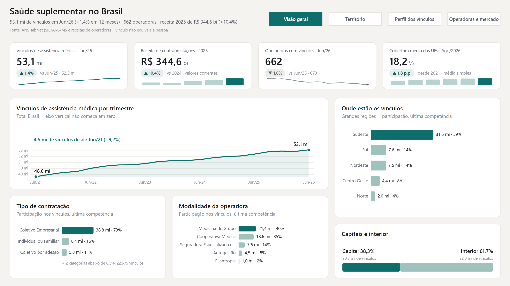
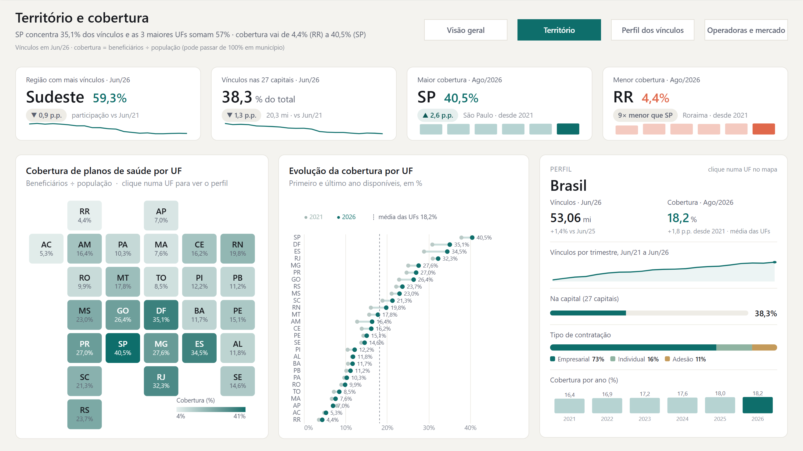
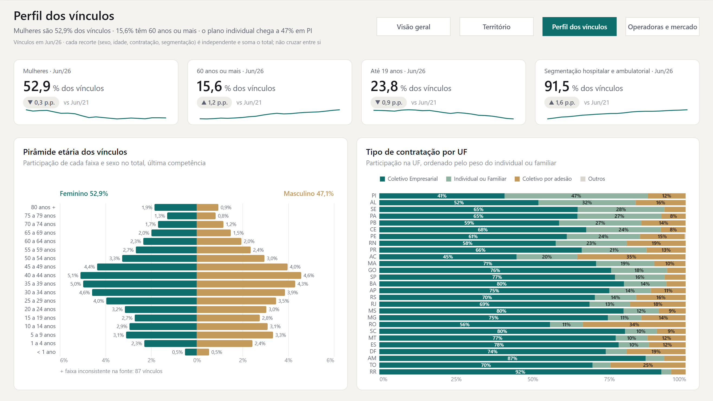
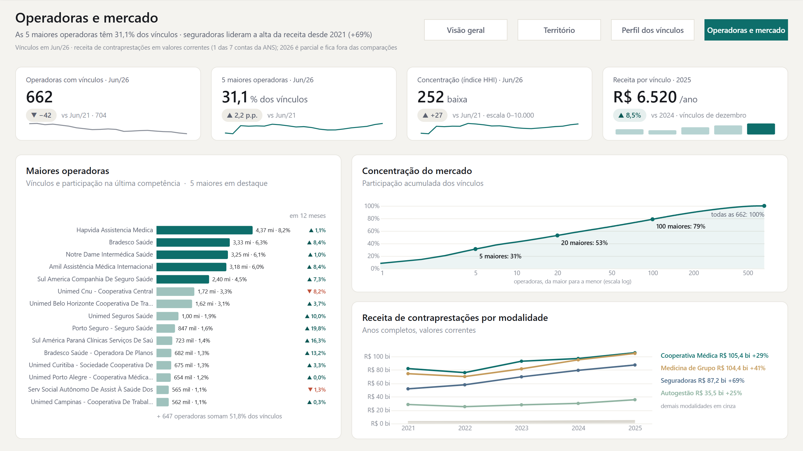
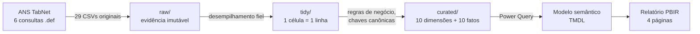

# Panorama da Saúde Suplementar no Brasil

Dashboard em Power BI sobre o mercado brasileiro de planos de saúde, construído de ponta a ponta a partir dos dados públicos da **ANS (Agência Nacional de Saúde Suplementar)**: extração, camada analítica validada, modelo semântico que impede dupla contagem e um relatório de quatro páginas com identidade visual própria.

### [▶ Abrir o relatório interativo](https://app.powerbi.com/view?r=eyJrIjoiMzE5YTFmZGItNDE3Ni00OGFjLTg2YTgtYTAxZTcxYjBlNWE2IiwidCI6IjcxZmE1OGY4LTc5NDktNGIwZS1iYzg2LTI4ODFlNzhjMmM3NyJ9)

Versão publicada na web (Power BI Publicar na Web), sem necessidade de login. Para melhor leitura, use a tela cheia.



## O que o painel mostra

Retrato de Jun/2026 (vínculos) e 2025 (receita, último ano completo):

- **53,1 milhões** de vínculos de assistência médica, **+1,4%** em 12 meses e **+9,2%** desde Jun/2021.
- **R$ 344,6 bi** em receita de contraprestações em 2025 (**+10,4%**, valores correntes), ou cerca de **R$ 6.520 por vínculo** por ano.
- **Mercado em consolidação:** 662 operadoras com vínculos (eram 704), as 5 maiores com **31,1%** dos vínculos e o índice HHI subindo de 225 para 252 (ainda baixa concentração).
- **Desigualdade territorial:** o Sudeste concentra **59,3%** dos vínculos; a cobertura vai de **4,4%** (RR) a **40,5%** (SP).
- **Perfil:** 52,9% dos vínculos são de mulheres, 15,6% de pessoas com 60 anos ou mais (+1,2 p.p. desde 2021) e 73% são planos coletivos empresariais. No Piauí, o plano individual chega a 47%.

## Páginas

| | |
|---|---|
|  **Visão geral**: tamanho e evolução do mercado, regiões, capitais × interior, contratação e modalidade. |  **Território e cobertura**: cartograma clicável por UF, evolução da cobertura e painel de perfil da UF selecionada. |
|  **Perfil dos vínculos**: pirâmide etária por sexo e tipo de contratação por UF. |  **Operadoras e mercado**: maiores operadoras, curva de concentração e receita por modalidade. |

## Arquitetura



- **Fonte única:** ANS TabNet (SIB/ANS/MS – 08/2026 e receitas do 2º trimestre de 2026). São 21 competências trimestrais (Jun/2021 a Jun/2026), cobertura anual e receita anual.
- **Camadas versionáveis:** dados em CSV, modelo em TMDL e relatório em PBIR (formato de projeto `.pbip`, em texto).
- **62 validações automáticas** na camada de dados (17 de reconciliação, 29 semânticas e 16 da camada analítica). Os números do relatório também foram conferidos por DAX contra os CSVs (`CONTEXTO.md` §6.1).

## Decisões que garantem números corretos

- **Sem dupla contagem.** Cada fato tem o seu grão, e os relacionamentos vão sempre de fato para dimensão, nunca de fato para fato. Medidas de recorte (sexo, faixa etária, contratação, segmentação) fixam o recorte e o nível geográfico, e recortes diferentes nunca se somam.
- **Vínculo é estoque.** As medidas de vínculos devolvem a competência mais recente do filtro, em vez de somar trimestres. A versão inicial somava 21 trimestres e inflava os gráficos cerca de 20 vezes.
- **Taxas não são somadas.** A cobertura usa o valor da UF ou do município no ano. A "cobertura média das UFs" é declarada como média simples, não como taxa nacional.
- **Épocas alinhadas.** A receita é anual e o vínculo é trimestral; a receita por vínculo divide a receita do ano pelos vínculos de dezembro do mesmo ano. O ano de 2026 é parcial e fica fora das comparações.
- **Resíduos preservados.** Vínculos sem UF ou município identificado continuam no total e são mostrados em notas, nunca descartados.

## Design

- **Tema próprio** (`ANSPanorama`): fundo claro quente, painéis brancos, um único acento verde-petróleo e coral só para alerta. Tipografia Segoe UI.
- **HTML Content (edição Secure)** para cabeçalhos com frase-resumo calculada, faixas de KPIs com variação e mini-série em SVG e o painel de perfil da UF. Tudo gerado por medidas DAX de apresentação, separadas das medidas de negócio.
- **Deneb (Vega-Lite)** para o que os visuais nativos não fazem bem: série com anotações, cartograma de UFs, halteres de cobertura, pirâmide etária, barras 100% por UF, curva de concentração e linhas de receita com rótulos diretos.
- **Interatividade onde ela tem função:** clicar numa UF do mapa filtra o painel de perfil e destaca os halteres, sem alterar os KPIs nacionais.

## Como reproduzir

Requisitos: Python 3.10+ (só biblioteca padrão) e Power BI Desktop. Os visuais HTML Content e Deneb são baixados automaticamente da AppSource ao abrir o relatório.

```bash
python meta/gera_tidy.py                    # raw/ -> tidy/
python meta/validar_semantica.py            # 29/29
python meta/valida_fase1r.py                # 17/17
python curated/scripts/build_curated.py     # tidy/ -> curated/
python curated/scripts/validar_curated.py   # 16/16
```

No Power BI Desktop:

1. Abra `powerbi/ANS_Panorama/ANS_Panorama.pbip`.
2. Em *Transformar dados → Editar parâmetros*, aponte `PastaCurated` para a pasta `curated/` do seu clone.
3. Clique em *Atualizar*.

## Estrutura

```
raw/          29 CSVs originais do TabNet (imutáveis)
tidy/         formato longo, fiel ao original
curated/      modelo analítico (dimensões, fatos, scripts e validações)
powerbi/      projeto .pbip: modelo semântico (TMDL) + relatório (PBIR) + tema
meta/         extrator, geradores e validadores
inventario/   inventário das bases, relatório de qualidade, regras de chave geográfica
docs/img/     capturas do relatório
```

A documentação técnica completa está em [`CONTEXTO.md`](CONTEXTO.md): regras de negócio, catálogo das medidas com o racional de cada uma, validações e problemas conhecidos. Os detalhes do Power BI estão em [`powerbi/ANS_Panorama/LEIA-ME.md`](powerbi/ANS_Panorama/LEIA-ME.md).

## Limitações

- O TabNet não oferece dado mensal: a menor granularidade é trimestral.
- A receita é uma das 7 contas de receitas e despesas da ANS (contraprestações), em valores correntes, sem correção pela inflação.
- Vínculo não é pessoa: um beneficiário pode ter mais de um plano.
- A taxa de cobertura é a razão entre beneficiários e população e pode passar de 100% em município.
- Não há cruzamento entre operadora e perfil demográfico na fonte.

## Licença e dados

O código (scripts, modelo e relatório) está sob a [licença MIT](LICENSE). Os dados são públicos, extraídos do [ANS TabNet](https://www.ans.gov.br/anstabnet/), e seguem os termos de uso da fonte.
